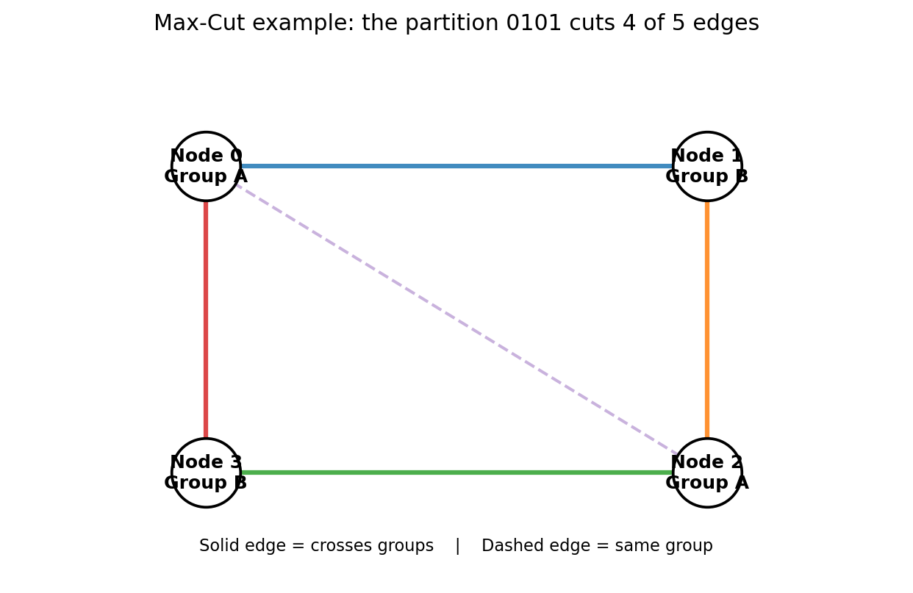
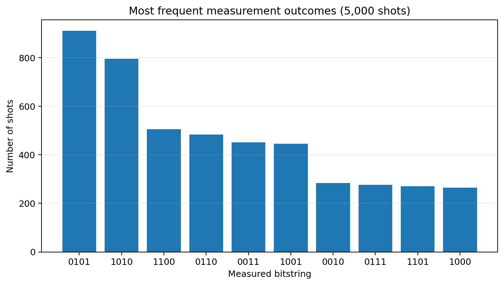

# 1. What are we building?

**Project:** Solve a small graph-partitioning problem using the Quantum Approximate Optimization Algorithm (QAOA).

**Framework:** PennyLane, using its `default.qubit` simulator. A small NumPy reference simulator is also included so the quantum-state calculations can be inspected and cross-checked.

**Project focus:** This implementation explores problem framing, algorithm formulation, Python implementation, parameter optimization, measurement, classical baseline comparison, testing and experimental limitations.

## The project in one sentence

We divide four connected nodes into two groups so that as many connections as possible cross between the groups, and use QAOA to search for a high-scoring partition.

# 2. Understand the problem visually

Imagine each circle is a node in a small network. Every node must be assigned to Group A or Group B. A connection earns one point when its two endpoints belong to different groups.



The five edges are: (0,1), (1,2), (2,3), (3,0), and (0,2).

A bitstring describes the assignment:

- `0` means Group A.
- `1` means Group B.

For `0101`, Nodes 0 and 2 are in Group A; Nodes 1 and 3 are in Group B. Four edges cross the groups, so the score is 4. The remaining edge, (0,2), stays inside Group A.

The exact best score is **4**. The assignment `1010` is equally good because it merely swaps the names of the two groups.

This is a small teaching graph. It is not a validated real-world energy-control model.

# 3. The mathematics, in simple steps

## 3.1 Binary objective

Let each node have a binary variable $x_i\in\{0,1\}$. For one edge $(i,j)$, define:

$$
C_{ij}=x_i(1-x_j)+x_j(1-x_i)
$$

The value is 1 when the endpoints differ and 0 when they are the same. The complete objective is:

$$
C(x)=\sum_{(i,j)\in E}w_{ij}C_{ij}, \qquad \text{maximize } C(x)
$$

All weights in this example are 1.

## 3.2 From bits to spins

Map each binary variable to a spin:

$$
s_i=1-2x_i,\qquad s_i\in\{-1,+1\}
$$

The edge score can then be written:

$$
C_{ij}=\frac{1-s_is_j}{2}
$$

In a quantum circuit, the Pauli-Z operator represents the spin measurement. So the quantum cost operator is:

$$
H_C=\sum_{(i,j)\in E}w_{ij}\frac{I-Z_iZ_j}{2}
$$

This is the same Max-Cut score expressed in quantum notation. Measuring the operator gives the cut value.

## 3.3 Why four qubits?

There is one qubit per node. Measuring four qubits produces a four-bit string, which directly describes the four node assignments. Four qubits have $2^4=16$ possible bitstrings. We can enumerate those 16 possibilities classically to know the exact answer for this tiny example.

# 4. How QAOA works

QAOA is a **hybrid quantum-classical algorithm**. The quantum circuit prepares candidate states and estimates their objective value. A classical optimizer changes the circuit parameters to improve that value.

The two Hamiltonians are:

$$
H_C=\sum_{(i,j)\in E}w_{ij}\frac{I-Z_iZ_j}{2}
$$

$$
H_M=\sum_i X_i
$$

The corresponding parameterized operations are:

$$
U_C(\gamma)=e^{-i\gamma H_C},\qquad U_M(\beta)=e^{-i\beta H_M}
$$

One QAOA layer applies a cost operation and then a mixer operation. We repeat this sequence $p$ times.

## The six steps

1. **Initialize:** begin with four qubits in `|0000>`.
2. **Superposition:** apply a Hadamard gate to every qubit, creating an equal superposition over 16 candidate bitstrings.
3. **Cost layer:** apply ZZ interactions associated with the graph edges. These phases encode the Max-Cut objective.
4. **Mixer layer:** apply RX rotations to the qubits. The mixer allows the state to explore different bitstrings.
5. **Parameter optimization:** a classical optimizer updates the angles gamma and beta to increase the expected cut value.
6. **Measurement:** execute the optimized circuit for many shots, count the bitstrings and calculate their cut values.

The optimizer minimizes the negative expected cut because many standard optimizers are designed to minimize a loss function.

# 5. How the code is organized

| File | What it does |
|---|---|
| `src/qaoa_maxcut/problem.py` | Defines the graph, scores assignments, checks QUBO/Ising equivalence and performs exact small-instance search. Includes a small `MaxCutProblem` class. |
| `src/qaoa_maxcut/pennylane_backend.py` | Builds the QAOA circuit with PennyLane, optimizes gamma/beta and samples the result. |
| `src/qaoa_maxcut/reference_simulator.py` | Implements the state-vector transformations explicitly with NumPy. |
| `src/qaoa_maxcut/optimize_reference.py` | Runs a derivative-free parameter search on the reference simulator. |
| `src/qaoa_maxcut/reporting.py` | Writes a JSON summary and CSV measurements. |
| `run_project.py` | Command-line entry point. |
| `tests/` | Checks the objective, exact optimum, QUBO/Ising mapping and state normalization. |

The reference simulator is deliberately small and educational; it is not intended to replace a production quantum simulator.

# 5A. PennyLane vocabulary

| PennyLane element | Plain-English meaning | Purpose in this project |
|---|---|---|
| `qml.device("default.qubit", wires=n)` | Create a simulator with n qubits | Four-qubit test device |
| `@qml.qnode(device)` | Turn a Python gate function into a quantum circuit | Executable circuit |
| `qml.Hadamard` | Create superposition from a zero state | Start with all possible assignments represented |
| `qml.IsingZZ` | Two-qubit Z-Z interaction | Apply an edge cost phase |
| `qml.RX` | Rotation around the X axis | Apply the mixer |
| `qml.Hamiltonian` | Sum of quantum operators | Represent the cut score |
| `qml.expval` | Expected measurement value | Objective value for optimization |
| `qml.sample` | Individual measured bit values | Create output bitstrings |
| `qml.AdamOptimizer` | Classical parameter optimizer | Update gamma and beta |

# 5B. Complexity - the DSA angle

- Edge-list storage uses $O(m)$ memory for $m$ edges.
- Scoring one bitstring takes $O(m)$ time because each edge is checked once.
- Exhaustive search takes $O(2^n m)$ time because it checks all $2^n$ assignments. It is only a verifier for this four-node example.
- A state-vector simulator stores $2^n$ complex amplitudes, requiring $O(2^n)$ memory. This grows quickly as qubits are added.
- At the logical circuit level, one QAOA layer has one cost interaction per edge and one mixer rotation per node. Hardware compilation can turn one logical operation into several native gates.

# 6. Run the project

Use Python 3.11 or 3.12 in a virtual environment.

## Windows PowerShell

```powershell
py -3.11 -m venv .venv
.venv\Scripts\Activate.ps1
python -m pip install --upgrade pip
python -m pip install -e ".[dev]"
```

## macOS / Linux

```bash
python3.11 -m venv .venv
source .venv/bin/activate
python -m pip install --upgrade pip
python -m pip install -e ".[dev]"
```

## Run the PennyLane backend

```bash
python run_project.py --backend pennylane --p 1 --steps 150 --restarts 4 --shots 5000 --seed 7
```

## Run the NumPy reference backend

```bash
python run_project.py --backend numpy --p 1 --steps 250 --restarts 10 --shots 5000 --seed 7
```

## Run the tests

```bash
python -m pip install -r requirements-dev.txt
python -m pytest -q
```

\newpage

# 7. Results from the verified reference run

The reference simulator was run with $p=1$, 10 independent initializations, 250 optimizer iterations per initialization, 5,000 measurement shots and random seed 7.

| Metric | Result |
|---|---:|
| Nodes / qubits | 4 |
| Edges | 5 |
| Candidate bitstrings | 16 |
| Exact classical optimum | 4.0000 |
| QAOA expected cut | 3.2371 |
| Expected-value approximation ratio | 80.93% |
| Optimal bitstrings | `0101`, `1010` |
| Optimal measurements | 1,706 / 5,000 |
| Optimal-sample frequency | 34.12% |



**How to understand the result:** the circuit does not return the best answer every time. Measurement is probabilistic. In this run, about 34% of the shots produced one of the two optimal bitstrings. The expected cut value averages the cut score over the full probability distribution before finite-shot sampling.

**Important verification status:** the NumPy reference backend was executed and the eight automated tests passed. PennyLane was not installed in the build environment, and package installation could not reach the package index. The PennyLane implementation is included in the project source, but you must install the requirements and execute its command yourself before describing that as a completed PennyLane run. No real quantum hardware was accessed.

# 8. Design choices and interpretation

## Project summary

The implementation maps a four-node Max-Cut instance to four qubits and encodes the objective in a cost Hamiltonian. Hadamard gates initialize an equal superposition, while alternating cost and mixer layers form the QAOA circuit. A classical optimizer adjusts gamma and beta to improve the expected cut value. The measured bitstrings are scored and compared with exhaustive classical search over all 16 possible assignments.

The verified reference experiment was run with the NumPy state-vector simulator. It produced an expected cut of approximately 3.24, while the exact classical optimum is 4. The two optimal bitstrings appeared in about 34 percent of 5,000 samples. This is a small simulator demonstration, not evidence of quantum speedup.

## Common follow-up questions

**What is p?** The number of cost/mixer layer pairs. More layers can improve the circuit's expressive power, but they also increase circuit depth and can make hardware noise more significant.

**Why use a classical optimizer?** QAOA is hybrid. The quantum circuit estimates the objective for the current parameters; the classical optimizer chooses updated parameters.

**Why run multiple initializations?** The parameter landscape is non-convex. Different starts can converge to different results.

**Why use brute force as a baseline?** There are only 16 possible assignments, so exhaustive search gives the exact answer. It is a correctness check for this tiny instance, not a scalable benchmark.

**Did you achieve quantum advantage?** No. The problem is deliberately tiny and easy for a classical computer. The purpose is to demonstrate the QAOA workflow and understand its constraints.

**What changes on hardware?** The circuit must be compiled to the device's native gates and connectivity. Gate errors, readout errors, decoherence, shot limits, queue time and provider costs can affect the result.

# 9. What I would do next

1. Execute the PennyLane implementation and compare its expected value and sample distribution with the reference simulator.
2. Compare $p=1$ and $p=2$ using equal optimization budgets.
3. Compare shot counts such as 100, 1,000 and 5,000.
4. Add a noise model and quantify how errors change the optimal-sample probability.
5. Compare QAOA with random search, local search and exact search on small graphs.
6. Compile and run on an available hardware provider only after checking device access, queue time, supported gates and cost.

The right engineering question is not simply "Did the quantum algorithm find a good answer?" It is "Did it find a sufficiently good answer under realistic noise, runtime, shot and cost constraints compared with the best classical approach?"

# 10. Reference material

- PennyLane, [QAOA for MaxCut](https://pennylane.ai/demos/tutorial_qaoa_maxcut) - official tutorial and PennyLane implementation.
- PennyLane, [Installation and dependencies](https://docs.pennylane.ai/en/stable/development/guide/installation.html).
- PennyLane, [Quantum circuits and QNodes](https://docs.pennylane.ai/en/stable/introduction/circuits.html).
- PennyLane, [Measurements and finite shots](https://docs.pennylane.ai/en/stable/introduction/measurements.html).
